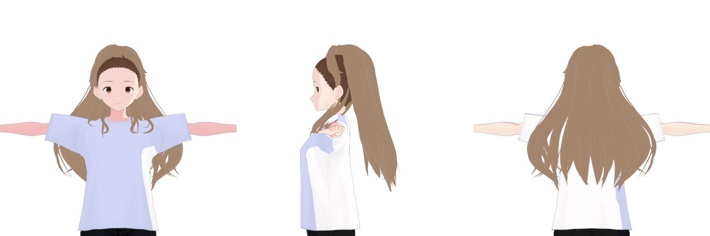

# mlx-hairdeck-swift

Swift-MLX port of [HairDeck](https://github.com/hyz317/HairDeck) (Apache-2.0): hair as a set of card tokens for
anime-style avatars. Work in progress — plan AB-P-0012 on the bridge.

## Status

| Phase | What | State |
|---|---|---|
| P1 | point cloud → Dora-VAE 1.1 encoder → point-cloud set DiT (Euler 50, CFG 2) → card VAE decoder → cards | parity gate passed, Table 1 reproduced (2026-11-13) |
| P2 | spring-bone chains: chain DiT, chain decoding, card VAE encoder + head-frame card tokens | parity gate passed, Table 4 reproduced (2026-11-13) |
| P3 | hair item `.glb` writer (card mesh, skinning, `VRMC_springBone`), no Blender | rig equal to the reference; `.glb` loads and swings in three-vrm; body read from any VRoid-style VRM; merged into Spec by Item Studio's `mergeVrm` with its springs (2026-11-13) |
| P4 | image path (SAM 3, BiRefNet, DINOv3, image DiT, colour model) | not started |
| P5 | MLXEngine `ModelPackage`, conformance, weights repo | not started |

## P1 results

Parity against the PyTorch reference (CPU, fp32; `tools/dump_p1_fixtures.py` → `Fixtures/p1`), CPU stream, max abs:
Dora tokens 2.9e-5, one DiT forward 4.0e-6, 50-step sample 7.3e-6, decoded cards 6.0e-8 (point counts and
classes equal). On the GPU the gate passes with `MLX_ENABLE_TF32=0`; with MLX's default TF32-class fp32 matmuls
(AB-L-0175) the 50-step tokens differ by 0.10 max abs (cosine 0.99997).

Table 1 on CHARM's 100 test point clouds, mean of seeds 0–2, same noise as the reference, evaluated with the
reference's own code (`tools/eval_p1.py`); Swift on the GPU with default TF32:

| | CD | EMD | HD | IoU | Orient. |
|---|---|---|---|---|---|
| Paper | 0.0066 | 0.0084 | 0.0242 | 0.867 | 16.8° |
| PyTorch on this Mac (MPS, bf16) | 0.00654 | 0.00837 | 0.02375 | 0.8666 | 16.74° |
| Swift-MLX | 0.00654 | 0.00836 | 0.02372 | 0.8655 | 16.66° |

Mac Studio (128 GB), release build, batch 10: condition 0.02 s, sampling 0.47 s, decoding 0.02 s per hairstyle;
peak MLX memory 2.8 GiB, peak RSS 1.3 GiB.

## P2 results

Parity against PyTorch (CPU, fp32; `tools/dump_p2_fixtures.py` → `Fixtures/p2`), max abs: chain DiT forward 1.0e-5,
50-step sample 1.1e-5, decoded chains 6e-17 (chain and joint counts equal), card VAE encoder latents 9.8e-6,
head-frame card tokens 1.5e-5.

Table 4 on the 58 test hairstyles with chains, mean of seeds 0–2, the reference's noise, scored by the reference's
evaluation (`tools/eval_p2.py`); Swift on the GPU with default TF32:

| | CD | Rec. | Prec. | Motion | Fit |
|---|---|---|---|---|---|
| Artists' cards — paper | 0.279 | 0.625 | 0.585 | 0.702 | 0.953 |
| Artists' cards — PyTorch on this Mac, same seeds | 0.294 | 0.596 | 0.573 | 0.697 | 0.950 |
| Artists' cards — Swift-MLX | 0.292 | 0.597 | 0.576 | 0.696 | 0.951 |
| Point-cloud cards — PyTorch on this Mac | 0.322 | 0.538 | 0.551 | — | 0.957 |
| Point-cloud cards — Swift-MLX (on the Swift cards) | 0.321 | 0.541 | 0.550 | — | 0.957 |

(Chains CD varies 0.270–0.297 between seeds; seeds 0–2 sit above the paper's mean on PyTorch too.)
Chains: 0.03 s per hairstyle for sampling (58 in one batch) and 0.03 s for the head-frame card tokens; peak MLX
memory 2.0 GiB.

## P3 results

The rig (`HairRig`: card mesh, UVs, card → chain assignment, vertex binding) against `hairdeck.vrm.prep` on HairDeck's
avatar body, for test row 1 (165 cards, 11 chains; `tools/dump_p3_fixtures.py` → `Fixtures/p3`): 21,048 vertices equal
to 2.2e-16, 51,300 faces equal, UVs to 1.8e-15, chain and card indices equal, weights to 2.0e-14. One vertex lies exactly
on a joint's bisector and picks the other of its two segments (the same binding: both at α = 0.5).

The hair item (`HairItem.glb`, 1.8 MB for this hairstyle): `inspect-vrm.mjs` reports no problems (11 springs, 55 spring
joints, 45 skin joints). In three.js 0.162 with `@pixiv/three-vrm-springbone` 3.5.5 (`tools/check_hair_item.mjs`) it loads
as a skinned mesh (weights sum to 1 within 3e-8) and under a 50° head turn the chain ends lag by up to 0.29 m and
are back at rest after 2.5 s. Rendered on the avatar in Blender (`tools/render_hair_item.py`):



**Body from a VRM** (`VRMBody`): the face mesh's POSITION bounds and the humanoid head bone, read from the file's
JSON, give the same placement as HairDeck's Blender-made fit of its avatar — head-frame points land within 1.0e-8 m,
the head joint within 3.6e-7 m. VRM 0.x and 1.0 files are both read; the item is written in the file's own axes, with
the head bone's rest rotation (Spec's is not identity).

**On Spec, through Item Studio's merge** (`tools/check_merged_vrm.mjs`, with `mergeVrm` extended to carry an item's
spring bones): Spec.vrm + the hair item → a VRM 1.0 file with 13 springs (2 of the body, 11 hair), every hair chain
intact under the head bone, the skinned hair within 2.4e-7 m of the item's vertices at rest, chain ends lagging up to
0.29 m under the 50° head turn and back at rest after 2.5 s. The inspector reports no problems.

Not in the item: the body's colliders (so HairDeck's rule that keeps the scalp part of a chain rigid inside the head
collider is not applied; Spec has none), and per-card colours (P4). The face mesh is found by name (`face`), which
holds for VRoid models.

## Use

Needs a HairDeck workspace with the released files (`scripts/setup/download_weights.py --only hairdeck dora`):
`third_party/weights/dora_vae_1_1/…safetensors`, `ckpt/pointcloud_model`, `ckpt/card_vae`, `data/token_stats.json`.

```bash
swift run -c release RunHairDeck gate --workspace HAIRDECK_ROOT --fixtures Fixtures/p1
swift run -c release RunHairDeck run --workspace HAIRDECK_ROOT --plys DIR --noise NOISE.npy --out RUN
swift run -c release RunHairDeck gate2 --workspace HAIRDECK_ROOT --fixtures Fixtures/p2
swift run -c release RunHairDeck chains --workspace HAIRDECK_ROOT --cards RUN --fits FITS.json --noise NOISE.npy --out CHAINS
swift run -c release RunHairDeck gate3 --fixtures Fixtures/p3
swift run -c release RunHairDeck hair-item --cards CARDS.json --chains CHAINS.json --vrm BODY.vrm --out HAIR.glb
swift run -c release RunHairDeck body --vrm BODY.vrm
```

`run` reads `DIR/{idx:03d}.ply` (10,000 points with normals, the `hair_reform.ply` format) and writes CHARM-format
cards to `RUN/JsonResults/{idx:03d}.json`. The noise is an input for now (`[rows, 192, 40]`), so results line up
with the reference sample for sample. `chains` needs each row's head fit (`FITS.json`: `[{"row", "k", "b"}]`,
p_head = k · p + b) and writes the chains in the head frame to `CHAINS/chains_head.json`; it also needs
`ckpt/chain_model`, `data/spring/chain_stats_head.json`, `data/token_stats_head.json`.

## Licences

Port code: MIT. HairDeck code and checkpoints: Apache-2.0. Dora-VAE 1.1 code and weights: Apache-2.0.
`NPYReader`, `SafetensorsHeader`, `Weights` and the base of `Ops` come from mlx-skintokens-swift (MIT, same author).
